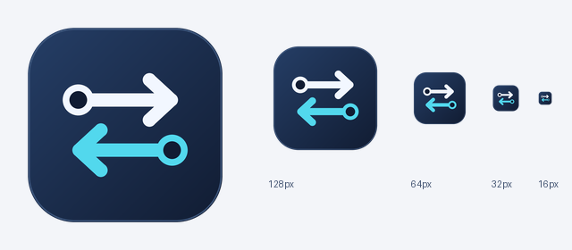

# 网络配置切换-可选择版

适用于 Windows 10/11，可手动选择目标网卡。

你可以：

- 从下拉框手动选择目标网卡
- 下拉框选择接口名，侧栏与概览卡显示网卡描述、当前 IPv4 和连接状态
- 读取当前网卡配置
- 手动填写 IP、子网掩码、网关、DNS
- 导入或导出 JSON 配置
- 应用静态 IP 或切换为 DHCP

应用配置通常需要管理员权限。如果应用失败，请右键 exe，选择“以管理员身份运行”。

## 运行

直接运行 `dist/网络配置切换-可选择版.exe`，无需安装 Python。

[下载 Windows 可执行文件](dist/网络配置切换-可选择版.exe) · [查看源码](network_switcher.py)



应用图标为深蓝圆角底、白色与青色双向箭头和网络节点，统一用于 exe、标题栏与侧栏。图标源文件位于 `assets/app-icon.svg`，预览为 `assets/app-icon.png`，Windows 多尺寸图标为 `assets/app-icon.ico`。需要重新导出时运行 `.\.venv\Scripts\python.exe assets\build_icon.py`。

从源码运行需要 Python 3.10 或更高版本：

```powershell
python -m venv .venv
.\.venv\Scripts\python.exe -m pip install -r requirements.txt
```

然后双击 `启动网络配置切换.bat`。读取配置不要求管理员权限；应用前程序会检查管理员权限。

## 修复与行为说明

- 界面采用深色侧栏与浅色配置卡片，分别展示网卡描述、连接状态、当前 IPv4 和网关；精简网卡下拉项以便选择。
- 双列地址与 DNS 表单、格式错误提示、DHCP 说明、管理员状态、加载进度及固定底部操作区；支持最小 980×660 窗口滚动查看。
- 配置详情与执行记录默认折叠，可手动展开。

- 系统命令使用独立参数列表执行，不经过命令行解释器；网卡使用接口索引定位，并在应用前重新核验名称。
- 使用 PowerShell JSON 获取 DHCP 状态、IPv4 地址、掩码、IPv4 网关和 DNS，避免依赖中英文文本解析。
- 校验连续子网掩码、单播地址、网关子网、DNS 顺序和配置文件字段。JSON 中的目标网卡不存在时拒绝导入。
- 读取和应用在后台执行，期间锁定操作控件；系统命令具有超时限制。
- 应用前自动保存原配置到 `%APPDATA%\NetworkSwitcher\backups`。任一命令失败后立即停止，提示可能已部分修改；不自动回滚。
- 导出默认目录为 `%APPDATA%\NetworkSwitcher\configs`，单文件 exe 的临时解压不会丢失导出配置。
- 静态模式下 DNS 留空表示清空静态 IPv4 DNS；DHCP 模式同时自动获取 IPv4 地址与 DNS。
- 此界面编辑第一个 IPv4 地址、默认网关及前两个 IPv4 DNS。应用会替换已有 IPv4 地址、默认网关和 IPv4 DNS，不编辑 IPv6 或自定义路由。
- 备份 JSON 可导入以恢复界面支持的基本 IPv4 配置；`system_details` 保存地址、网关和 DNS 列表。多 IP、多网关，以及 DHCP 地址配合手动 DNS 等高级配置，需要使用系统工具按记录恢复。

## 验证与打包

```powershell
.\.venv\Scripts\python.exe -m unittest -v
.\.venv\Scripts\python.exe -m pip install pyinstaller==6.22.3
.\build.ps1
```

回归测试中的配置应用均使用模拟命令，不会修改本机网络。

界面过渡：详情展开/收起采用约 240ms 缓出动画；表单、焦点与按钮颜色采用 120–200ms 渐变。快速反向操作会接续当前状态。加载轨道保持固定高度，短任务延迟展示，减少闪烁与布局抖动。
